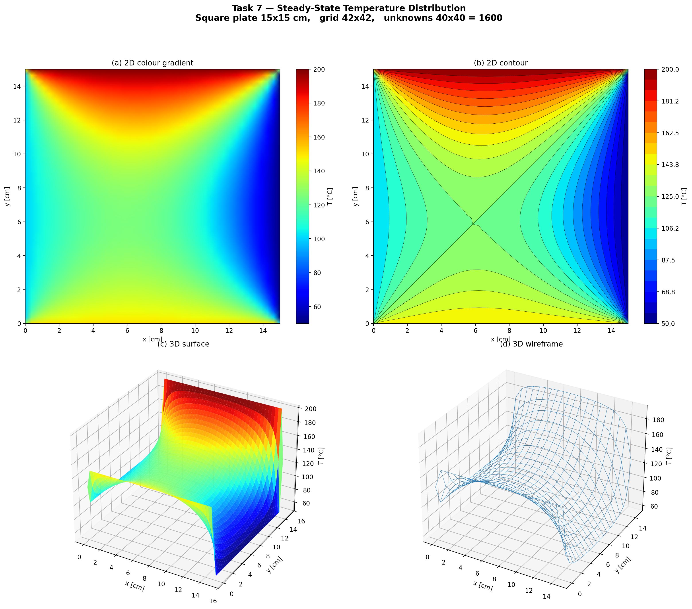

# Steady-State Heat Plate

Finite-difference solution of the steady-state temperature distribution on a square plate with fixed temperatures on its four edges.

## Model

The temperature `T(x, y)` satisfies the Laplace equation `d2T/dx2 + d2T/dy2 = 0`. On a uniform grid, every interior node gets the five-point equation

```
T[i-1, j] + T[i+1, j] + T[i, j-1] + T[i, j+1] - 4 * T[i, j] = 0
```

Known boundary values move to the right-hand side, which gives a linear system `A * t = b` for the interior unknowns. The matrix is stored in sparse form (`scipy.sparse`) and solved directly with `spsolve`.

Setup in `main.py`: plate 15 x 15 cm, 41 intervals per side, boundary temperatures bottom 150 C, left 100 C, top 200 C, right 50 C.

## Run

```bash
python main.py
```

The script opens a window, saves a four-panel figure (color map, contour plot, 3D surface, 3D wireframe) and prints a summary.

## Results

| Quantity | Value |
|---|---|
| Grid | 42 x 42 nodes |
| Unknowns | 40 x 40 = 1600 |
| Matrix size | 1600 x 1600 |
| Non-zero entries | 7840 |
| Temperature range | 50 C to 200 C |

In a separate check, the temperature at the center of the plate is 125.0 C, which equals the mean of the four edge temperatures, and the residual `|A * t - b|` is about 3e-13. The solution is bounded by the edge values, as the maximum principle for the Laplace equation requires.



## Notes

* The corner nodes get the average of their two edge temperatures for plotting. The five-point stencil never uses them, so they do not affect the solution.
* The solver is a direct method. For much finer grids, an iterative solver would use less memory.
