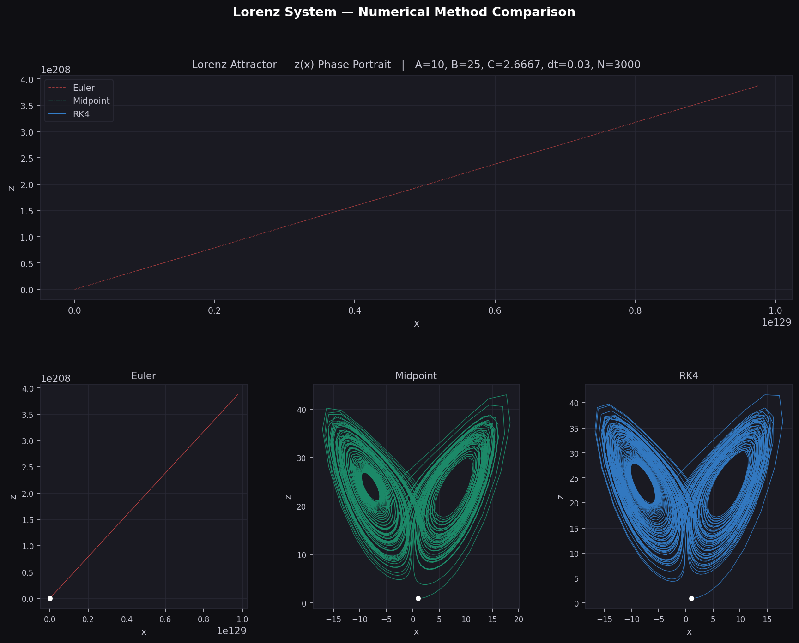

# Lorenz Attractor

Comparison of three numerical methods (Euler, midpoint, RK4) on the Lorenz system, a standard example of chaotic dynamics.

## Model

```
dx/dt = A * (y - x)
dy/dt = -x * z + B * x - y
dz/dt = x * y - C * z
```

Parameters: `A = 10`, `B = 25`, `C = 8/3`, start point `(1, 1, 1)`, time step `dt = 0.03`, `N = 3000` steps (90 time units). The script plots the `z(x)` projection of the trajectory for each method.

## Run

```bash
python main.py
```

The script opens a window and saves `lorenz_plot.png` in the current folder.

## Results

The comparison is about how each method behaves at a fairly large step, not about a single correct trajectory. Because the system is chaotic, any numerical solution eventually leaves the true trajectory.

* **Euler:** the values grow to the order of 10^4 by t = 1.14 s and overflow to infinity at t = 1.44 s (step 48). The method is unstable at this step size, so the Euler curve in the plot stops after a few dozen points.
* **Midpoint:** stays bounded on the attractor but departs from a fine reference solution early. The distance to the reference exceeds 1 at t = 0.36 s.
* **RK4:** follows the reference much longer. The distance to the reference exceeds 1 at t = 15.93 s.

The reference used for these distances is RK4 with a 60 times smaller step (`dt = 0.0005`). This comparison is a separate check, it is not part of the script.



## Notes

* Only the `x` and `z` coordinates are stored and plotted.
* The step size `dt = 0.03` is intentionally coarse to make the differences between the methods visible.
