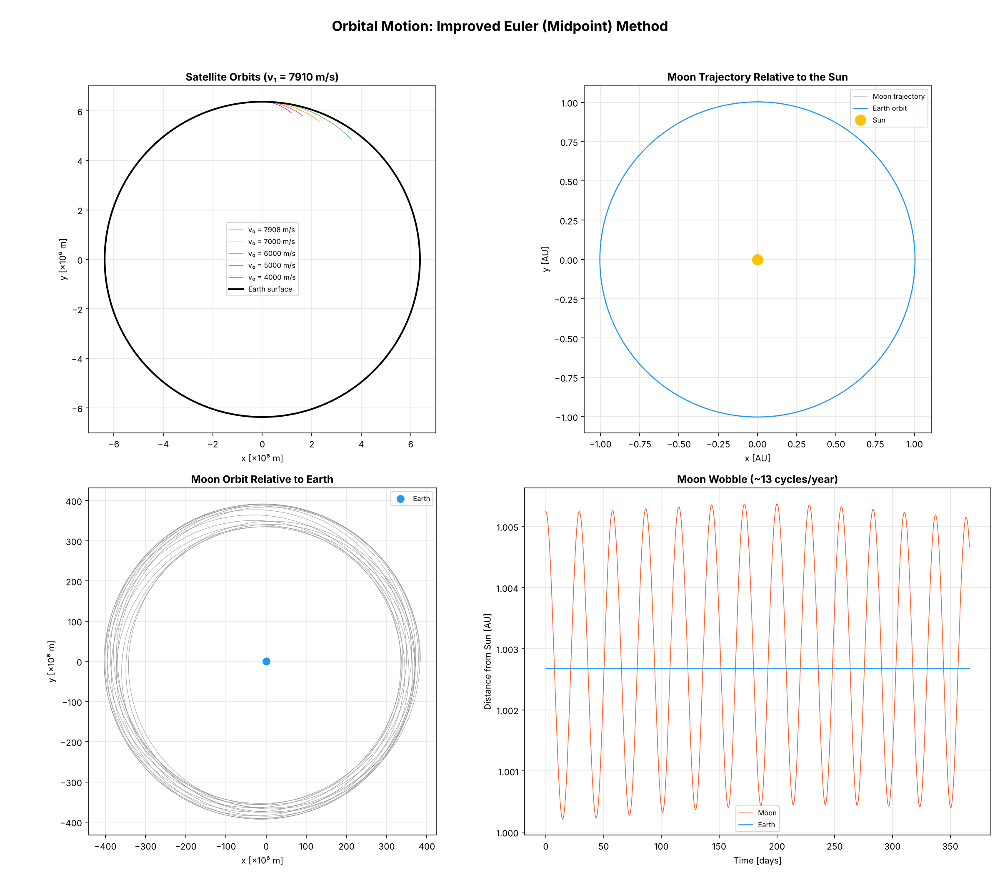

# Orbital Motion

Simulation of the Earth and the Moon moving around the Sun, and of artificial satellites launched around the Earth. All trajectories are integrated with the midpoint (improved Euler) method.

## Model

Newtonian gravity with `G = 6.6743e-11`, Sun mass `1.989e30 kg`, Earth mass `5.972e24 kg` and Moon mass `7.347e22 kg`.

* **Earth:** starts on a circular orbit of radius `1.5e11 m` around the Sun and feels only the Sun.
* **Moon:** starts `384,400 km` from the Earth with the circular speed relative to the Earth added to the Earth's velocity. It feels the Sun and the Earth.
* **Satellites:** start at the Earth's surface and move in the Earth's gravity only. The simulation stops if a satellite falls below 95 percent of the Earth's radius.
* **Time steps:** 3600 s for the Earth and the Moon (8800 steps, about one year), 20 s for satellites (15,000 steps, about 3.5 days).

## Run

```bash
python main.py
```

The script opens a window, saves `orbital_overview.png` in the current folder and prints the first cosmic speed and the orbital periods.

## Results

The printed values are: first cosmic speed 7910 m/s, Earth period 366.7 days, Moon period 27.5 days, Earth speed 29,749 m/s.

In a headless run of this script:

* A satellite launched at 7908 m/s stays between 6369 km and 6376 km from the Earth's center for all 15,000 steps, which is a near circular orbit.
* Satellites launched at 7000 m/s, 6000 m/s, 5000 m/s and 4000 m/s fall back to the Earth, because the perigee of their elliptical orbit is below the surface.
* The Earth stays at 1.00267 AU from the Sun for the whole year, which matches the starting radius.
* The distance between the Moon and the Earth varies between about 332,000 km and 403,000 km over the year.



## Limitations

* The Earth is not pulled by the Moon, so the Earth-Moon barycenter motion is not modeled. The Moon is treated as a light body in the field of the Sun and the Earth.
* The orbits are circular at the start. Real orbits are slightly elliptical, so the Moon distance range above differs from the real one.
* The panel title "Moon Wobble (~13 cycles/year)" is a description, not a measured result of the script.
