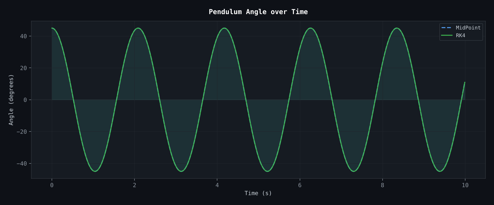
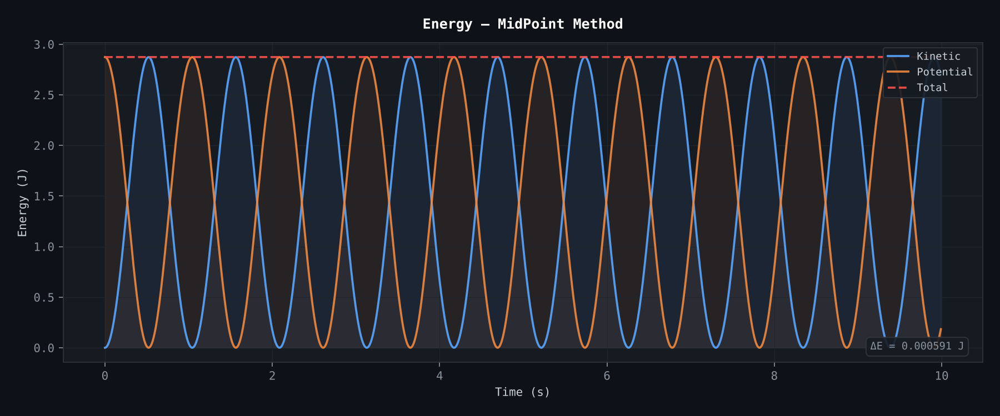
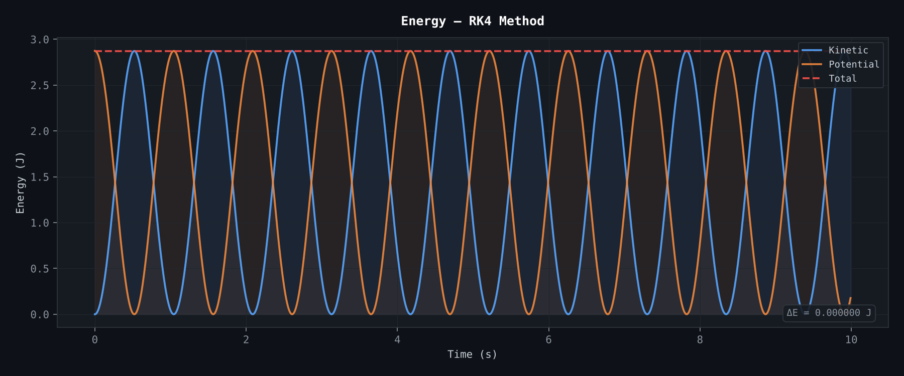

# Pendulum Simulation

Simulation of a mathematical (rigid, frictionless) pendulum with the midpoint method and the fourth-order Runge-Kutta method (RK4). The two methods are compared by how well they conserve total energy.

## Model

The pendulum angle `alpha` follows

```
d(alpha)/dt = omega
d(omega)/dt = -(g / r) * sin(alpha)
```

The full `sin(alpha)` is used, so the model is valid for large amplitudes and not only for small angles. Kinetic energy is `0.5 * m * (r * omega)^2` and potential energy is `m * g * r * (1 - cos(alpha))`. For a frictionless pendulum the sum of the two should stay constant, so any drift in total energy is numerical error.

Parameters in `main.py`: `g = 9.81 m/s^2`, `r = 1 m`, `m = 1 kg`, start angle 45 degrees, start angular velocity 0, `dt = 0.01 s`, duration 10 s.

## Run

```bash
python main.py
```

The script prints the energy drift of both methods and saves three figures in the current folder.

## Results

Total energy drift is measured as `|E(end) - E(start)|`:

| Method | Order | Energy drift after 10 s |
|---|---|---|
| Midpoint | 2 | 5.91e-4 J |
| RK4 | 4 | 2.89e-8 J |

RK4 conserves energy about 20,000 times better than the midpoint method at the same step size. The midpoint method needs two derivative evaluations per step and RK4 needs four, so RK4 costs about twice as much per step.







## Notes

* The drift is measured only at the end of the run, not as a maximum over time.
* `main.py` also contains the earlier interactive version of the program (with an Euler method and user input) inside a triple-quoted string. It is not executed.
