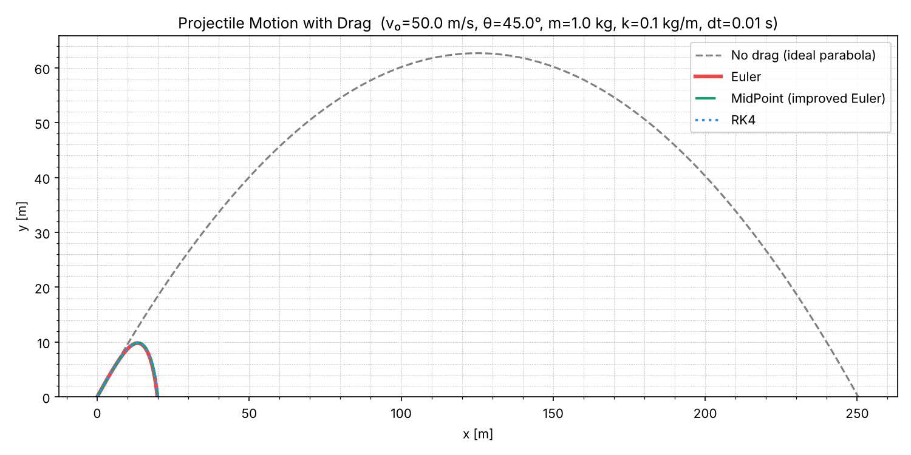

# Projectile Motion Simulation

Simulation of projectile motion with quadratic air drag. The trajectory is computed with three ODE integrators, Euler, midpoint (improved Euler) and fourth-order Runge-Kutta (RK4), and compared with a no-drag reference.

## Physics

The projectile is subject to gravity and to a drag force proportional to the square of its speed and opposite to its velocity:

```
ax = -(k / m) * V * vx
ay = -g - (k / m) * V * vy
```

where `V = sqrt(vx^2 + vy^2)`. With drag, the path is no longer a parabola. The range and the maximum height are smaller and the descent is steeper than the ascent. The script uses `g = 10 m/s^2`.

The four coupled first-order equations `dx/dt = vx`, `dy/dt = vy`, `dvx/dt = ax`, `dvy/dt = ay` are integrated until the projectile reaches `y < 0`.

| Method | Order | Derivative calls per step |
|---|---|---|
| Euler | 1 | 1 |
| Midpoint | 2 | 2 |
| RK4 | 4 | 4 |

## Run

```bash
pip install matplotlib
python main.py
```

The script asks for the parameters and rejects invalid values:

```
Initial speed v0 [m/s] (> 0): 50
Launch angle [deg] (1 - 89): 45
Mass m [kg] (> 0): 1
Drag coefficient k [kg/m] (>= 0): 0.1
Time step dt [s] (0.0001 - 0.1): 0.01
```

It prints a table of range and maximum height for each method and saves `trajectory.png` in the current folder.

| Parameter | Valid range |
|---|---|
| Initial speed | above 0 m/s |
| Launch angle | 1 to 89 degrees |
| Mass | at least 0.001 kg |
| Drag coefficient | 0 or more kg/m |
| Time step | 0.0001 to 0.1 s |

## Example results

With `v0 = 50 m/s`, 45 degrees, `m = 1 kg`, `k = 0.1 kg/m`, `dt = 0.01 s`:

| Method | Range | Maximum height |
|---|---|---|
| Euler | 19.832 m | 9.804 m |
| Midpoint | 19.998 m | 9.861 m |
| RK4 | 19.994 m | 9.858 m |
| No drag | 250.669 m | 62.677 m |

Drag reduces the range from about 250 m to about 20 m. Midpoint and RK4 agree to within 0.004 m, and Euler undershoots by about 0.16 m relative to RK4.



## Limitations

* The simulation stops at the first step with `y < 0` and does not interpolate to the ground. The reported range can exceed the true one by up to `vx * dt`. With `k = 0`, `dt = 0.1` and the example launch, midpoint and RK4 report 251.02 m while the analytic range is 250 m.
* The no-drag reference is itself computed numerically with Euler steps, so it is not an exact parabola. At `dt = 0.1` it gives 254.56 m instead of 250 m.
* The step size is limited to 0.1 s. The script does not check stability for other drag and speed combinations.
