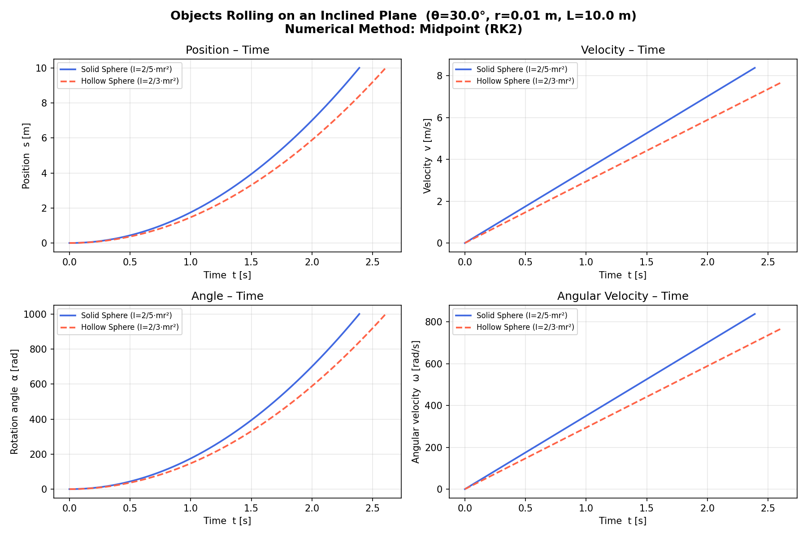

# Rolling Motion on an Inclined Plane

Simulation of a solid sphere and a hollow (thin-shell) sphere rolling without slipping down a ramp. The script compares their motion and shows that the body with the smaller moment of inertia arrives first.

## Model

For rolling without slipping, the acceleration along the ramp is

```
a = g * sin(theta) / (1 + I / (m * r^2))
```

with `I / (m r^2) = 2/5` for a solid sphere and `2/3` for a hollow sphere. The state is position, speed, rotation angle and angular velocity. It is integrated with the midpoint method until the sphere has traveled the length of the ramp.

Parameters in `rolling_simulation.py`: `g = 9.81 m/s^2`, ramp angle 30 degrees, sphere radius 0.01 m, ramp length 10 m, `dt = 0.001 s`.

## Run

```bash
python rolling_simulation.py
```

The script prints the results, opens a window with four plots (position, speed, rotation angle and angular velocity against time) and saves `rolling_simulation.png`.

## Results

| Body | Acceleration | Arrival time | Analytic arrival time |
|---|---|---|---|
| Solid sphere | 3.5036 m/s^2 | 2.390 s | 2.389 s |
| Hollow sphere | 2.9430 m/s^2 | 2.607 s | 2.607 s |

The analytic times follow from `t = sqrt(2 * L / a)`. The numerical times differ only by the step size, because the arrival time is detected at the first step past the end of the ramp.



## Notes

* The acceleration is constant, so the midpoint method integrates this problem exactly up to rounding. The project demonstrates the effect of the moment of inertia, not the accuracy of the integrator.
* The sphere radius does not change the arrival time. It only sets the angular velocity through `omega = v / r`.
* The printed check `omega = v / r` is not an independent test, because the angular velocity is computed from the same acceleration divided by `r`.
* Rolling without slipping is assumed. The script does not check whether the friction needed for it is available.
