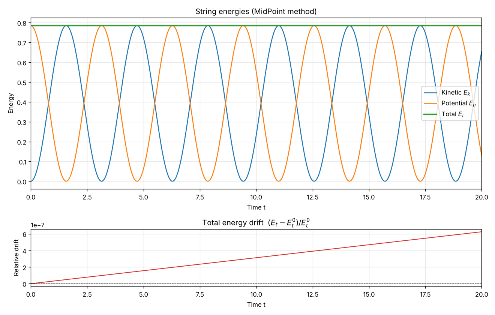
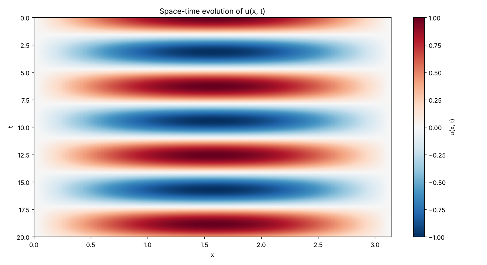
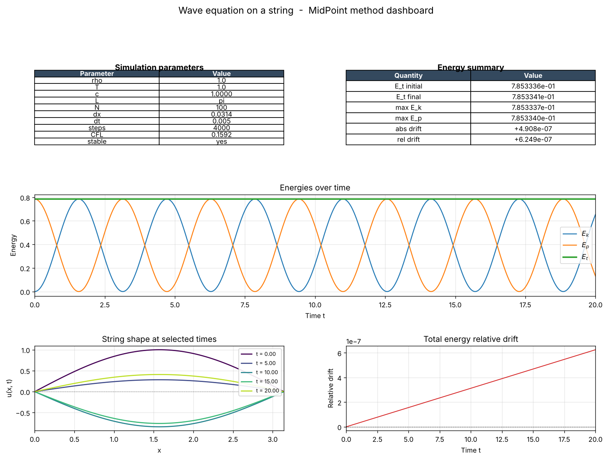

# String Wave Simulation

Simulation of the one-dimensional wave equation on a string fixed at both ends, solved with the midpoint method. The script checks numerical stability and tracks the kinetic, potential and total energy of the string.

## Model

```
d2u/dt2 = c^2 * d2u/dx2,    c = sqrt(T / rho)
```

The second spatial derivative is replaced with a central finite difference, which turns the equation into a system of ordinary differential equations for `u` and `v = du/dt`. That system is integrated with the midpoint method. Both ends of the string stay at zero displacement.

Parameters in `main.py`: `rho = 1`, `T = 1`, string length `pi`, `N = 100` intervals, `dt = 0.005 s`, 4000 steps (20 time units). Initial shape is `u(x, 0) = sin(x)` with zero initial velocity.

The stability check prints the CFL number `c * dt / dx`, here 0.159, which is below the limit of 1.

## Run

```bash
python main.py
```

The script prints the CFL number and the energy drift and saves six figures in the current folder: `energies.png`, `snapshots_grid.png`, `snapshots_overlay.png`, `heatmap.png`, `summary_table.png` and `dashboard.png`.

## Results

| Quantity | Value |
|---|---|
| Total energy at t = 0 | 0.78533 |
| Total energy at t = 20 | 0.78533 |
| Relative energy drift | 6.2e-7 |

In a separate check against the analytic solution `sin(x) * cos(t)`, the largest absolute error at t = 20 is 6.7e-4. This comparison is not part of the script.







## Notes

* The discrete energy at t = 0 differs slightly from the continuous value `pi/4`, because the energy is computed on the grid.
* The midpoint method is not energy-preserving, so the total energy drifts slowly. Over this run the drift is small.
